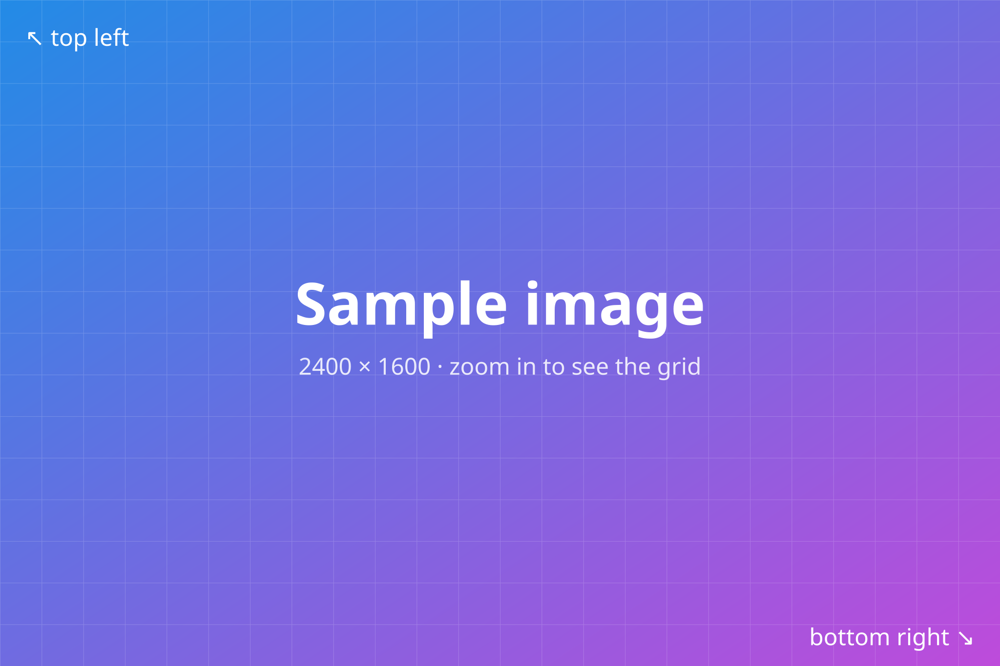

# Release notes

`mantine-doc-viewer` shows **PDF**, image, text, code and markdown files with one component.
See the [Mantine docs](https://mantine.dev) or jump to [installation](#installation).



## Installation

```bash
yarn add mantine-doc-viewer pdfjs-dist @mantine/code-highlight
```

```tsx
import { DocViewer } from 'mantine-doc-viewer';

function Demo() {
  return <DocViewer src="/files/report.pdf" h={600} />;
}
```

## What's new

| Feature | Status |
| --- | --- |
| PDF search | Done |
| Thumbnails | Done |
| Office files | ~~Planned~~ Not planned |

- [x] Text selection
- [x] Image zoom and pan
- [ ] Office files

> Markdown is rendered without raw HTML, so untrusted files are safe to preview.

<script>alert('raw HTML is not rendered')</script>
